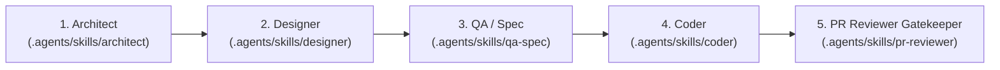

# Pulse Pipeline — Agentic SDLC & Workspace Rules (`AGENTS.md`)

This file defines always-on repository rules, architectural invariants, and the **Agentic SDLC workflow** for **Pulse Pipeline (PP)**.

---

## 1. Core Architectural Invariants

Every agent working in this repository MUST enforce these invariants:

1. **Multi-User Isolation from Day One (`user_id` Scoping):**
   - Although PP is initially operated for a single user, **every database table, SQL query, API endpoint, and MCP tool that accesses health data MUST be scoped by `user_id`**.
   - Never write global/unscoped queries on `daily_summaries`, `intraday_metrics`, `sleep_sessions`, or `provider_connections`.
   - **System-context exception:** background jobs (e.g. the nightly sync in `internal/sync`) may enumerate *which* users to process via a dedicated, explicitly named store query (e.g. `ListConnectionsDueForSync`) that returns only identifiers and connection status — never health data or tokens across users. All subsequent reads and writes for each user must be scoped by that user's `user_id`. Such queries must never be reachable from API endpoints or MCP tools.
   - **Authentication-boundary exception:** the queries that turn a validated credential into a `user_id` run before any `user_id` is known: `GetSessionByTokenHash` (keyed by the SHA-256 of a session secret) and `GetUserIDByIdentity` (keyed by a validated OpenID `(issuer, subject)`). They return only the `user_id` and session or identity metadata, never health data or tokens, and only the auth middleware, sign-in and sign-out may call them (ADR-0005 §2–3). Handlers take the `user_id` from the authenticated session, never from the request.
2. **Multi-Provider Abstraction (`HealthProvider` Interface):**
   - All external wearable APIs (starting with the **Google Health API** for Fitbit Air) must implement the canonical `HealthProvider` interface in `backend/internal/provider/`.
   - Domain and dashboard logic must only depend on normalized Pulse Pipeline domain types—never on raw Google Health or Fitbit JSON payloads.
3. **Compile-Time Type Safety & Explicit Error Handling:**
   - **Go (`backend/`, `mcp/`):** Use `sqlc` + `pgx` for type-safe SQL. Wrap all errors with context (`fmt.Errorf("fetching daily summary: %w", err)`). Never ignore returned errors without explicit justification.
   - **TypeScript (`web/`):** Enable `"strict": true` in `tsconfig.json`. Never use `any`.
4. **Desktop + Mobile PWA Parity:**
   - Every UI view in `web/` must work seamlessly on both **Desktop (`1280x800`)** and **Mobile (`390x844`)** viewports and remain 100% testable via standard DOM selectors in **Playwright**.

---

## 2. The 5-Role Agentic SDLC Pipeline

Pulse Pipeline uses five specialized agent skills under `.agents/skills/` to maintain engineering quality and gatekeep code changes. `.claude/skills` is a symlink to `.agents/skills` so Claude Code discovers the same skills; the skills themselves are plain Markdown and work in any agent runtime, so agents that do not auto-discover skills should read the relevant `SKILL.md` directly.

| Role | Skill Location | Responsibility & Gatekeeping Criteria |
| :--- | :--- | :--- |
| **Architect** | `.agents/skills/architect/SKILL.md` | Designs PostgreSQL schemas, Go interfaces (`HealthProvider`), MCP contracts, and writes Architecture Decision Records (`docs/adr/`). |
| **Designer** | `.agents/skills/designer/SKILL.md` | Specifies responsive Desktop + Mobile PWA layouts, chart visualizations, loading/empty/error states, and accessibility (`a11y`). |
| **QA / Spec** | `.agents/skills/qa-spec/SKILL.md` | Writes executable test specifications, Go Testcontainers integration tests, and Playwright E2E scenarios for desktop & mobile viewports. |
| **Coder** | `.agents/skills/coder/SKILL.md` | Implements backend (Go), MCP (Go), and frontend (React/TS) code adhering to architectural specs and passing all tests/linters. |
| **PR Reviewer** | `.agents/skills/pr-reviewer/SKILL.md` | Runs `.agents/skills/pr-reviewer/scripts/pr_gatekeeper.py` (forbidden-file scan, `make test`, `make lint`) and reviews the diff against the dimensions in `.agents/skills/pr-reviewer/references/dimensions.md` before PR merge. |

---

## 3. Git & PR Workflow

- Work in focused feature branches (`feat/<phase>-<topic>`, `fix/<topic>`, `docs/<topic>`).
- Never commit secrets, `.env` files, OAuth client secrets, or personal notes files.
- Before opening or merging a Pull Request, run `python3 .agents/skills/pr-reviewer/scripts/pr_gatekeeper.py` (which runs `make test` and `make lint`) and complete the `pr-reviewer` dimension reviews.
