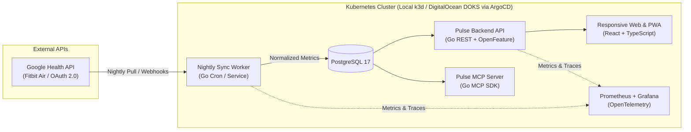

# Pulse Pipeline — Architecture & Roadmap

## Overview & Vision

**Pulse Pipeline (PP)** is a personal health data platform initially built for single-user wearable tracking (Fitbit Air via the Google Health API), but architected from day one so that it can scale to **multiple users** and **multiple health data providers** (e.g., Garmin, Oura, Apple Health, Withings).

PP serves dual purposes:

1. **A Personal Software Product:** A daily-driver health analytics platform (with potential to be open-sourced or monetized later).
2. **A Hands-On Learning & Engineering Platform:** A practical testbed for **Go**, modern time-series data modeling on **PostgreSQL**, **Model Context Protocol (MCP)**, **Agentic SDLC workflows**, **OpenFeature / A/B testing**, **OpenTelemetry / Prometheus / Grafana observability**, **"Docs as Code"**, and **Cloud GitOps (Kubernetes, ArgoCD, Terraform + Terragrunt)**.

---

## Technical Stack & Key Decisions

| Layer                   | Technology Choice                                                            | Rationale                                                                                                                                                                                                                                                              |
| :---------------------- | :--------------------------------------------------------------------------- | :--------------------------------------------------------------------------------------------------------------------------------------------------------------------------------------------------------------------------------------------------------------------- |
| **Backend & Ingestion** | **Go (1.26+)**                                                               | Compile-time static typing, first-class REST & gRPC support for the Google Health API, tiny container images, and cloud-native/K8s synergy.                                                                                                                            |
| **Database**            | **Standard PostgreSQL 17** (`pgx` + `sqlc` + `golang-migrate`)               | Handles millions of time-series rows with standard composite indexing, runs identically in local Docker and managed cloud DBs, and generates compile-time type-safe Go code from SQL via `sqlc`.                                                                       |
| **Web & Phone App**     | **React + TypeScript + Vite + Tailwind CSS (PWA)**                           | Single responsive codebase for desktop browsers and installable mobile home-screen apps (Progressive Web App) without native build clunkiness; 100% DOM-compatible with Playwright E2E agents. Can be wrapped in Capacitor later if store distribution is ever needed. |
| **MCP Server**          | **Go (`modelcontextprotocol/go-sdk`)**                                       | Shares domain models and database query packages directly with the Go backend, compiling to a single fast binary.                                                                                                                                                      |
| **Health Data Source**  | **Google Health API** (`developers.google.com/health`)                       | Modern successor to the Fitbit Web API using Google OAuth 2.0, reconciled data streams, and REST/gRPC endpoints, abstracted behind a `HealthProvider` interface.                                                                                                       |
| **Testing & QA**        | **Go `testing` + Testcontainers + Vitest + Playwright Agents**               | Spec-driven unit tests, real PostgreSQL container integration tests, and automated desktop/mobile E2E verification via Playwright agents.                                                                                                                              |
| **Feature Flags & A/B** | **OpenFeature + Flipt**                                                      | Vendor-neutral OpenFeature SDK paired with a GitOps-friendly, Go-native feature flag and cohort evaluation engine.                                                                                                                                                     |
| **Observability**       | **OpenTelemetry + Prometheus + Grafana**                                     | Standardized telemetry across Go services, metrics scraping via Prometheus, and operational dashboards in Grafana.                                                                                                                                                     |
| **Documentation**       | **Astro Starlight**                                                          | "Docs as Code" Markdown/MDX site with Mermaid diagram support for both developer and user documentation.                                                                                                                                                               |
| **Cloud & GitOps**      | **DigitalOcean (DOKS) + Terraform + Terragrunt + ArgoCD** (plus local `k3d`) | Predictable personal cloud billing on DigitalOcean for Kubernetes, while using a free-tier Google Cloud project strictly for Google Health API & OAuth 2.0 credentials.                                                                                                |

---

## System Architecture

---

## Phased Implementation Roadmap

### Phase 0: Repository Foundation & Agentic SDLC

Establish the monorepo layout, local development tooling, quality gates, and custom AI agents for the software development lifecycle.

- [x] Revise initial requirements into a structured architecture & phased roadmap (`ROADMAP.md`)
- [x] Initialize `.gitignore` and project `README.md`
- [x] Create monorepo directory structure (`backend/`, `web/`, `mcp/`, `infra/`, `docs/`)
- [x] Set up `Taskfile.yml` / `Makefile` and `docker-compose.yml` (local PostgreSQL 17, Flipt, Prometheus, Grafana)
- [x] Design and configure Agentic SDLC workflows & gatekeepers:
  - [x] **Architect Agent:** Reviews schema changes, interfaces, and ADRs
  - [x] **Designer Agent:** Guides responsive UI/UX and dashboard layout specs
  - [x] **Coder Agent:** Implements features following Go and TypeScript conventions
  - [x] **QA / Spec Agent:** Authors test specifications and Playwright E2E scenarios
  - [x] **PR Reviewer / Gatekeeper Agent:** Enforces code quality, security, and test coverage
- [x] Configure GitHub Actions CI pipeline (linting, type-checking, unit/integration test gates)

---

### Phase 1: Core Domain, Database & Google Health API Ingestion (Go + Postgres)

Build the multi-user, multi-provider data foundation and nightly ingestion service.

- [x] Design canonical PostgreSQL schema with `golang-migrate` migrations:
  - [x] `users` & `provider_connections` (encrypted OAuth 2.0 tokens, scopes, sync cursors — AES-256-GCM ciphertext columns, ADR-0004 §4)
  - [x] `daily_summaries` (steps, resting HR, HRV, sleep score, calories, SpO2)
  - [x] `intraday_metrics` (high-frequency time-series points indexed by `(user_id, metric_type, recorded_at)`)
  - [x] `sleep_sessions` & `sleep_stages`
  - [x] `sync_runs` (audit log of nightly pull jobs, status, records ingested, errors)
- [x] Set up `sqlc` and `pgx` in `backend/` for type-safe SQL data access
- [x] Define the `HealthProvider` adapter interface (`FetchDailySummaries`, `FetchIntradayMetrics`, `FetchSleepSessions`, `RefreshAuth`)
- [x] Implement a deterministic `MockHealthProvider` generating realistic synthetic health data for local dev and automated testing
- [x] Implement the `GoogleHealthProvider` (Google OAuth 2.0 flow + Google Health API client for Fitbit Air data, AES-256-GCM token encryption per ADR-0002 §3 — see ADR-0004; accounts are linked with `pulse-worker connect-google` until the Phase 2 web callback)
- [x] Build the nightly sync worker (idempotent upserts, retry/backoff, backfill support, manual/backfill CLI — see ADR-0003; the HTTP manual trigger moves to Phase 2 with API auth)
- [x] Write Go unit tests and Testcontainers-based PostgreSQL integration tests (per-package suites against a real PostgreSQL 17 container via `internal/testdb`, plus `pulse-worker` command tests; `make cover` reports coverage)

---

### Phase 2: Authenticated API, Web & Phone App (PWA) Dashboards + Playwright E2E Agents

Add the authenticated read API the dashboards need, then build the responsive frontend for desktop browsers and as an installable phone app. The API contract, authentication, read model and queued manual sync are decided in [ADR-0005](docs/adr/0005-api-auth-and-read-model.md). Each dashboard ships as one vertical slice — store query, endpoint, UI, Vitest and Playwright specs together — rather than leaving tests to the end. **2a** (foundation + Overview + Connections) is a usable daily driver on its own; **2b** completes the analytics views and installability.

**2a — Foundation**

- [x] Accept ADR-0005 (API shape, Google sign-in + sessions, read model, queued manual sync, E2E auth) and write the [Designer spec](docs/design/phase-2-dashboards.md) for the layout shell and dashboards (tokens, loading/empty/error states, a11y)
- [x] Scaffold `web/` (React, TypeScript `strict`, Vite, Tailwind CSS) with all five Make scripts from day one (`build`, `typecheck`, `lint`, `test`, `test:e2e`) and a dev proxy from `/api` to the API, so CI gates the frontend immediately
- [x] API foundation: `/api/v1` on `net/http`, OpenAPI contract with generated Go and TypeScript types (drift-checked in CI like `sqlc`), RFC 9457 errors, `Cache-Control: no-store`, graceful shutdown, no query strings or cookies in logs
- [x] Authentication: Google sign-in (OIDC + PKCE) for `PULSE_ALLOWED_EMAILS`, `user_identities` + server-side `sessions` (migration `000004`), `HttpOnly` session cookie, `http.CrossOriginProtection`; every handler scoped to the session's `user_id` with cross-user isolation tests; `pulse-worker bind-google-identity` keeps a Phase 1 user's history
- [ ] Deterministic E2E stack: `seed-dev -user-id -connection` fixture users per state and viewport project, a polling worker, `PULSE_DEV_NOW` fixed clock and a development-only login (`ENV=development` + `PULSE_ENABLE_DEV_LOGIN`); Playwright desktop (`1280x800`) and mobile (`390x844`) projects
- [ ] Build responsive layout shell (desktop sidebar navigation + mobile bottom tab bar with safe-area support, signed-in/out states)

**2a — Slices**

- [ ] **Overview Dashboard:** step goal ring (new `users.step_goal` setting), sleep duration (derived from sleep sessions), resting HR and HRV for the selected local day, last sync status; settings for timezone, step goal and primary provider (`PATCH /api/v1/me`)
- [ ] **Sync & Connections View:** connections and recent `sync_runs`; Google Health web linking via a _Web application_ OAuth client, reusing the ADR-0004 exchange, scope check and vault and recording the issuing client per connection; "Sync now" queues a manual run (`sync_requested_at`, `202 Accepted`) that the worker picks up on its next poll (amends ADR-0003 §5)

**2b — Analytics & installability**

- [ ] **Heart Rate & HRV View:** bucketed intraday heart rate timeline (`date_bin` aggregation, ≤ 1,440 points) and 7/30/90-day resting HR & HRV trends with 7-day means
- [ ] **Sleep Analytics View:** sleep stages breakdown (Deep, REM, Light, Awake), time asleep vs in bed, bedtime/wake consistency (no sleep score: Google Health does not provide one)
- [ ] Configure Progressive Web App (PWA) manifest, icons, and an app-shell-only service worker (API responses are never cached); verify installability with Playwright — installing on a real phone needs HTTPS and lands with Phase 5 (or a local tunnel)

Deferred out of Phase 2: a derived **readiness score** (no upstream source; becomes the Phase 4 dashboard-insights experiment) and merged multi-provider views.

---

### Phase 3: Agentic Data Access — Pulse MCP Server (Go)

Expose health data safely to AI assistants and agents via the Model Context Protocol.

- [ ] Build the MCP server in Go using `modelcontextprotocol/go-sdk`, moved to `backend/cmd/mcp` so it reuses `internal/readmodel` and `internal/store` (ADR-0005 §10)
- [ ] Implement MCP Tools:
  - [ ] `get_daily_summary` (fetch daily metrics for a date or range)
  - [ ] `query_metric_timeseries` (query heart rate, steps, HRV, or sleep with aggregation buckets)
  - [ ] `analyze_trends` (compare rolling averages across weeks/months)
  - [ ] `get_sync_status` / `trigger_sync` (inspect or kick off a Google Health sync)
- [ ] Implement MCP Resources & Prompt templates for personal health insights
- [ ] Write unit and integration tests for the MCP server

---

### Phase 4: Observability, Feature Flags & A/B Testing

Instrument the platform for production-grade visibility and controlled feature rollouts.

- [ ] Integrate **OpenTelemetry** across the Go API, nightly sync worker, and MCP server
- [ ] Configure **Prometheus** metrics collection (API latency histograms, Google Health API quota/rate-limit counters, sync job duration & row counts)
- [ ] Build & version-control **Grafana** dashboards (System Health, Sync Pipeline Telemetry, Database Performance)
- [ ] Integrate **OpenFeature** + **Flipt** for feature flags and A/B testing:
  - [ ] Implement backend and frontend flag evaluation
  - [ ] Create an A/B experiment on dashboard insights/visualizations (e.g. a derived readiness score, deferred from Phase 2) and track experiment metrics in Prometheus/Grafana

---

### Phase 5: Documentation ("Docs as Code") & Cloud GitOps

Document the system for developers and users, and deploy to Kubernetes via Terraform, Terragrunt, and ArgoCD.

- [ ] Scaffold `docs/` using **Astro Starlight**:
  - [ ] **Developer Docs:** Architecture Decision Records (ADRs), Local Setup, Database Schema, Adding a New Health Provider, Agentic Workflow Guide, MCP Reference
  - [ ] **User Docs:** Connecting Google Health / Fitbit, Installing the Mobile PWA, Understanding Dashboard Metrics
- [ ] Create production multi-stage `Dockerfile`s for `backend`, `mcp`, `web`, and `docs`
- [ ] Author Kubernetes manifests / Helm charts and **ArgoCD** Application definitions (validate locally on `k3d`)
- [ ] Build **Terraform + Terragrunt** infrastructure modules in `infra/`:
  - [ ] DigitalOcean Kubernetes (DOKS) cluster, Container Registry, and PostgreSQL storage
  - [ ] Bootstrap ArgoCD for GitOps continuous delivery of the application, observability stack, and docs site
