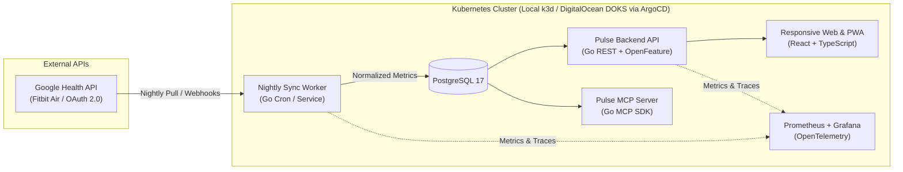

# Pulse Pipeline — Architecture & Roadmap

## Overview & Vision

**Pulse Pipeline (PP)** is a personal health data platform initially built for single-user wearable tracking (Fitbit Air via the Google Health API), but architected from day one so that it can scale to **multiple users** and **multiple health data providers** (e.g., Garmin, Oura, Apple Health, Withings).

PP serves dual purposes:

1. **A Personal Software Product:** A daily-driver health analytics platform (with potential to be open-sourced or monetized later).
2. **A Hands-On Learning & Engineering Platform:** A practical testbed for **Go**, modern time-series data modeling on **PostgreSQL**, **Model Context Protocol (MCP)**, **Agentic SDLC workflows**, **OpenFeature / A/B testing**, **OpenTelemetry / Prometheus / Grafana observability**, **"Docs as Code"**, and **Cloud GitOps (Kubernetes, ArgoCD, Terraform + Terragrunt)**.

---

## Technical Stack & Key Decisions

| Layer                   | Technology Choice                                                            | Rationale                                                                                                                                                                                                                                                              |
| :---------------------- | :--------------------------------------------------------------------------- | :--------------------------------------------------------------------------------------------------------------------------------------------------------------------------------------------------------------------------------------------------------------------- |
| **Backend & Ingestion** | **Go (1.23+)**                                                               | Compile-time static typing, first-class REST & gRPC support for the Google Health API, tiny container images, and cloud-native/K8s synergy.                                                                                                                            |
| **Database**            | **Standard PostgreSQL 17** (`pgx` + `sqlc` + `golang-migrate`)               | Handles millions of time-series rows with standard composite indexing, runs identically in local Docker and managed cloud DBs, and generates compile-time type-safe Go code from SQL via `sqlc`.                                                                       |
| **Web & Phone App**     | **React + TypeScript + Vite + Tailwind CSS (PWA)**                           | Single responsive codebase for desktop browsers and installable mobile home-screen apps (Progressive Web App) without native build clunkiness; 100% DOM-compatible with Playwright E2E agents. Can be wrapped in Capacitor later if store distribution is ever needed. |
| **MCP Server**          | **Go (`modelcontextprotocol/go-sdk`)**                                       | Shares domain models and database query packages directly with the Go backend, compiling to a single fast binary.                                                                                                                                                      |
| **Health Data Source**  | **Google Health API** (`developers.google.com/health`)                       | Modern successor to the Fitbit Web API using Google OAuth 2.0, reconciled data streams, and REST/gRPC endpoints, abstracted behind a `HealthProvider` interface.                                                                                                       |
| **Testing & QA**        | **Go `testing` + Testcontainers + Vitest + Playwright Agents**               | Spec-driven unit tests, real PostgreSQL container integration tests, and automated desktop/mobile E2E verification via Playwright agents.                                                                                                                              |
| **Feature Flags & A/B** | **OpenFeature + Flipt**                                                      | Vendor-neutral OpenFeature SDK paired with a GitOps-friendly, Go-native feature flag and cohort evaluation engine.                                                                                                                                                     |
| **Observability**       | **OpenTelemetry + Prometheus + Grafana**                                     | Standardized telemetry across Go services, metrics scraping via Prometheus, and operational dashboards in Grafana.                                                                                                                                                     |
| **Documentation**       | **Astro Starlight**                                                          | "Docs as Code" Markdown/MDX site with Mermaid diagram support for both developer and user documentation.                                                                                                                                                               |
| **Cloud & GitOps**      | **DigitalOcean (DOKS) + Terraform + Terragrunt + ArgoCD** (plus local `k3d`) | Predictable personal cloud billing on DigitalOcean for Kubernetes, while using a free-tier Google Cloud project strictly for Google Health API & OAuth 2.0 credentials.                                                                                                |

---

## System Architecture

---

## Phased Implementation Roadmap

### Phase 0: Repository Foundation & Agentic SDLC

Establish the monorepo layout, local development tooling, quality gates, and custom AI agents for the software development lifecycle.

- [x] Revise initial requirements into a structured architecture & phased roadmap (`ROADMAP.md`)
- [x] Initialize `.gitignore` and project `README.md`
- [ ] Create monorepo directory structure (`backend/`, `web/`, `mcp/`, `infra/`, `docs/`)
- [ ] Set up `Taskfile.yml` / `Makefile` and `docker-compose.yml` (local PostgreSQL 17, Flipt, Prometheus, Grafana)
- [ ] Design and configure Agentic SDLC workflows & gatekeepers:
  - [ ] **Architect Agent:** Reviews schema changes, interfaces, and ADRs
  - [ ] **Designer Agent:** Guides responsive UI/UX and dashboard layout specs
  - [ ] **Coder Agent:** Implements features following Go and TypeScript conventions
  - [ ] **QA / Spec Agent:** Authors test specifications and Playwright E2E scenarios
  - [ ] **PR Reviewer / Gatekeeper Agent:** Enforces code quality, security, and test coverage
- [ ] Configure GitHub Actions CI pipeline (linting, type-checking, unit/integration test gates)

---

### Phase 1: Core Domain, Database & Google Health API Ingestion (Go + Postgres)

Build the multi-user, multi-provider data foundation and nightly ingestion service.

- [ ] Design canonical PostgreSQL schema with `golang-migrate` migrations:
  - [ ] `users` & `provider_connections` (encrypted OAuth 2.0 tokens, scopes, sync cursors)
  - [ ] `daily_summaries` (steps, resting HR, HRV, sleep score, calories, SpO2)
  - [ ] `intraday_metrics` (high-frequency time-series points indexed by `(user_id, metric_type, recorded_at)`)
  - [ ] `sleep_sessions` & `sleep_stages`
  - [ ] `sync_runs` (audit log of nightly pull jobs, status, records ingested, errors)
- [ ] Set up `sqlc` and `pgx` in `backend/` for type-safe SQL data access
- [ ] Define the `HealthProvider` adapter interface (`FetchDailySummaries`, `FetchIntradayMetrics`, `FetchSleepSessions`, `RefreshAuth`)
- [ ] Implement a deterministic `MockHealthProvider` generating realistic synthetic health data for local dev and automated testing
- [ ] Implement the `GoogleHealthProvider` (Google OAuth 2.0 flow + Google Health API client for Fitbit Air data)
- [ ] Build the nightly sync worker (idempotent upserts, retry/backoff, backfill support, manual trigger endpoint)
- [ ] Write Go unit tests and Testcontainers-based PostgreSQL integration tests

---

### Phase 2: Web & Phone App (PWA) Dashboards + Playwright E2E Agents

Create the responsive frontend accessible on desktop browsers and installable as a mobile phone app.

- [ ] Scaffold `web/` using React, TypeScript, Vite, and Tailwind CSS
- [ ] Build responsive layout shell (desktop sidebar navigation + mobile bottom tab bar with safe-area support)
- [ ] Implement core health dashboards:
  - [ ] **Overview Dashboard:** Daily readiness/pulse summary, step goal ring, sleep duration, resting HR
  - [ ] **Heart Rate & HRV View:** Intraday heart rate timeline and 7/30/90-day resting HR & HRV trends
  - [ ] **Sleep Analytics View:** Sleep stages breakdown (Deep, REM, Light, Awake) and consistency trends
  - [ ] **Sync & Connections View:** Google Health OAuth connect button, last sync status, manual sync trigger
- [ ] Configure Progressive Web App (PWA) manifest, icons, and service worker for mobile home-screen installation
- [ ] Write frontend unit/component tests (Vitest + Testing Library)
- [ ] Create E2E specifications and automate desktop + mobile viewport verification using **Playwright agents**

---

### Phase 3: Agentic Data Access — Pulse MCP Server (Go)

Expose health data safely to AI assistants and agents via the Model Context Protocol.

- [ ] Build `mcp/` server in Go using `modelcontextprotocol/go-sdk`
- [ ] Implement MCP Tools:
  - [ ] `get_daily_summary` (fetch daily metrics for a date or range)
  - [ ] `query_metric_timeseries` (query heart rate, steps, HRV, or sleep with aggregation buckets)
  - [ ] `analyze_trends` (compare rolling averages across weeks/months)
  - [ ] `get_sync_status` / `trigger_sync` (inspect or kick off a Google Health sync)
- [ ] Implement MCP Resources & Prompt templates for personal health insights
- [ ] Write unit and integration tests for the MCP server

---

### Phase 4: Observability, Feature Flags & A/B Testing

Instrument the platform for production-grade visibility and controlled feature rollouts.

- [ ] Integrate **OpenTelemetry** across the Go API, nightly sync worker, and MCP server
- [ ] Configure **Prometheus** metrics collection (API latency histograms, Google Health API quota/rate-limit counters, sync job duration & row counts)
- [ ] Build & version-control **Grafana** dashboards (System Health, Sync Pipeline Telemetry, Database Performance)
- [ ] Integrate **OpenFeature** + **Flipt** for feature flags and A/B testing:
  - [ ] Implement backend and frontend flag evaluation
  - [ ] Create an A/B experiment on dashboard insights/visualizations and track experiment metrics in Prometheus/Grafana

---

### Phase 5: Documentation ("Docs as Code") & Cloud GitOps

Document the system for developers and users, and deploy to Kubernetes via Terraform, Terragrunt, and ArgoCD.

- [ ] Scaffold `docs/` using **Astro Starlight**:
  - [ ] **Developer Docs:** Architecture Decision Records (ADRs), Local Setup, Database Schema, Adding a New Health Provider, Agentic Workflow Guide, MCP Reference
  - [ ] **User Docs:** Connecting Google Health / Fitbit, Installing the Mobile PWA, Understanding Dashboard Metrics
- [ ] Create production multi-stage `Dockerfile`s for `backend`, `mcp`, `web`, and `docs`
- [ ] Author Kubernetes manifests / Helm charts and **ArgoCD** Application definitions (validate locally on `k3d`)
- [ ] Build **Terraform + Terragrunt** infrastructure modules in `infra/`:
  - [ ] DigitalOcean Kubernetes (DOKS) cluster, Container Registry, and PostgreSQL storage
  - [ ] Bootstrap ArgoCD for GitOps continuous delivery of the application, observability stack, and docs site
